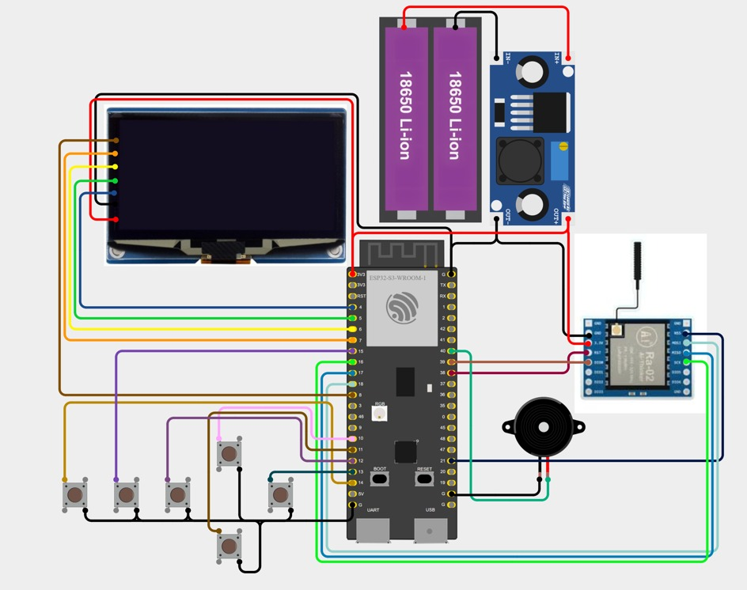
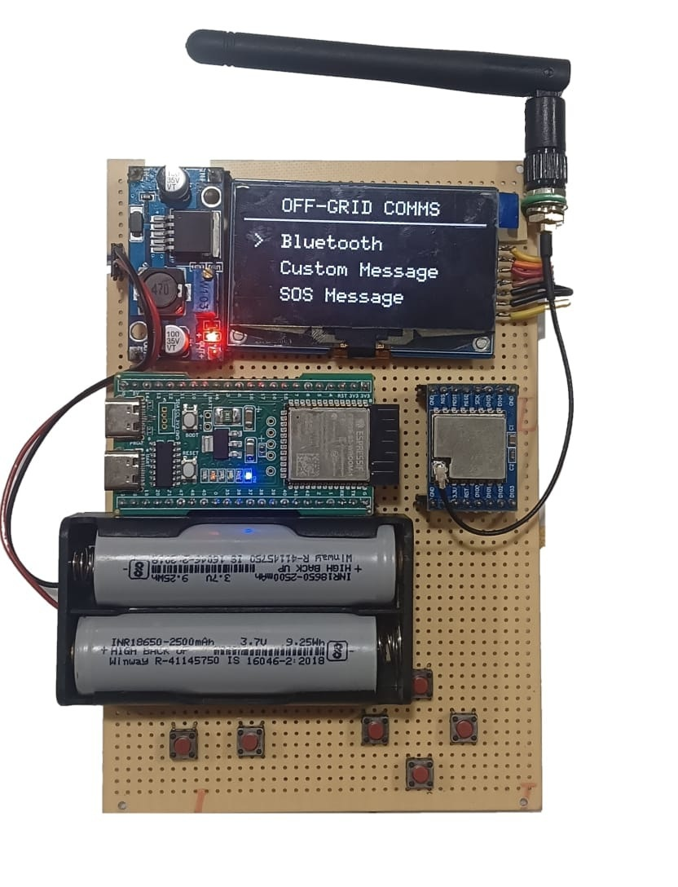

# Offgrid Communication V2

### A LoRa-Based Off-Grid Wireless Messaging System

---

## 📌 Project Overview

Offgrid Communication V2 is an embedded wireless communication system designed to enable text-based communication without relying on cellular networks, Wi-Fi, or internet connectivity.

The system uses the **ESP32-S3 microcontroller** and the **SX1278 RA-02 LoRa transceiver module** to transmit and receive messages wirelessly over long distances with low power consumption.

It provides an OLED-based user interface, Bluetooth-enabled messaging, Morse code input, and an SOS alert mechanism for emergency communication.

The primary objective is to develop a portable and independent communication device that can be useful in remote areas, outdoor activities, and situations where conventional communication infrastructure is unavailable.

## 🎯 Objectives

- Develop an independent wireless messaging system.
- Establish communication using LoRa RF technology.
- Implement Bluetooth-based message input.
- Provide an alternative Morse code input mechanism.
- Implement an SOS alert and acknowledgement system.
- Develop a simple button-operated OLED interface.
- Explore low-power and long-range communication possibilities.

## 🛠️ Hardware Components

| Component | Description |
|---|---|
| ESP32-S3-WROOM-1 DevKit | Main microcontroller |
| SX1278 RA-02 | 433 MHz LoRa transceiver |
| 2.42-inch OLED Display | User interface |
| Push Buttons (6) | Menu navigation and input |
| Active Buzzer | Audio notifications |
| Li-ion Battery | Portable power supply |
| Buck Converter | Power regulation |
| LoRa Antenna | RF transmission and reception |

## ⚙️ Technologies Used

- **Microcontroller:** ESP32-S3
- **Programming Language:** Embedded C/C++
- **Development Environment:** Arduino IDE
- **Wireless Communication:** LoRa (SX1278)
- **Short-Range Communication:** Bluetooth Low Energy (BLE)
- **Display Interface:** SPI OLED
- **User Input:** Physical push buttons
- **RF Frequency:** 433 MHz

## 🚀 Key Features

### 1. LoRa Wireless Communication

- Wireless transmission and reception of text messages.
- Communication without internet or cellular connectivity.
- Uses the SX1278 LoRa transceiver.
- Supports communication between compatible devices.

### 2. Bluetooth Messaging

- Receives text messages from a connected smartphone.
- Automatically forwards received Bluetooth messages through LoRa.
- Reduces the need for manual message entry.

### 3. Morse Code Input

- Provides an alternative method for entering messages.
- LEFT button generates a dot (.)
- RIGHT button generates a dash (-).
- SELECT button converts Morse code into characters.
- Supports composing and transmitting messages.

### 4. SOS Emergency System

- Dedicated SOS transmission mode.
- Repeated SOS alert transmission until manually stopped.
- Receivers can acknowledge incoming SOS alerts.
- Provides visual notifications through the OLED display.
- Uses received signal strength (RSSI) as an indication of signal quality.

### 5. OLED-Based User Interface

- Menu-driven navigation.
- Six-button control system.
- Displays transmitted and received messages.
- Provides communication and SOS status information.

## 🔌 Hardware Architecture

The ESP32-S3 acts as the main processing unit and controls the connected peripherals.

- The SX1278 handles LoRa transmission and reception.
- The OLED displays menus, messages, and system status.
- Push buttons provide user input.
- Bluetooth enables smartphone-based message entry.
- The buzzer provides audio notifications for SOS-related events.
- The battery supplies power through a buck converter.

## 🔌 Circuit Diagram

The following diagram illustrates the hardware connections between the ESP32-S3, SX1278 LoRa module, OLED display, push buttons, buzzer, and power supply.



## 📷 Project Prototype

The image below shows the assembled hardware prototype of Offgrid Communication V2, featuring the ESP32-S3 development board, SX1278 LoRa module, OLED display, antenna, battery supply, and physical control buttons.



## 📱 Android Application

The project uses **Serial Bluetooth Terminal** for Bluetooth-based text communication between an Android phone and the ESP32-S3 device.

- **Application:** Serial Bluetooth Terminal
- **Platform:** Android
- **Purpose:** Sending text messages to the device over Bluetooth.

[Download Serial Bluetooth Terminal – Google Play Store](https://play.google.com/store/apps/details?id=de.kai_morich.serial_bluetooth_terminal)

## 📂 Project Structure

```text
Offgrid-Communication-V2/
│
├── offgrid_esp32_s3.ino
│
├── README.md
│
└── images/
    ├── circuit-diagram.png
    └── offgrid-prototype.png
```

## 💻 Software Requirements

- Arduino IDE
- ESP32 Board Package
- LoRa Library (Sandeep Mistry)
- U8g2 Graphics Library
- ESP32 BLE Library

Install the required libraries through the Arduino IDE Library Manager where applicable.

## 🔧 Setup and Installation

### 1. Clone the Repository

```bash
git clone https://github.com/Karthikeyan-S-007/Offgrid-Communication-V2.git
```

### 2. Open the Project

Open the project folder and load `offgrid_esp32_s3.ino` using Arduino IDE.

### 3. Install Dependencies

Install the required ESP32 board package and libraries.

### 4. Configure the Board

- Select the appropriate ESP32-S3 development board.
- Select the correct COM port.
- Verify the hardware connections.

### 5. Upload the Firmware

Compile and upload the firmware to the ESP32-S3.

Repeat the setup for the second communication device.

## 📡 Working Principle

1. The user enters a message through Bluetooth or the Morse code interface.
2. The ESP32-S3 processes the message.
3. The message is transmitted using the SX1278 LoRa module.
4. The receiving device detects and processes the incoming packet.
5. The received message is displayed on the OLED screen.
6. SOS alerts follow a dedicated transmission and acknowledgement process.

## 🔮 Future Improvements

- Improved communication reliability and error handling.
- Device authentication.
- Battery monitoring and power optimization.
- Improved RF range and antenna optimization.
- Message history and storage.
- Additional communication modes.
- Integration with a gateway for wider network connectivity.

## ⚠️ Limitations

- Communication range depends on antenna design, terrain, obstacles, and RF configuration.
- LoRa is designed for low-data-rate communication and is not suitable for conventional high-quality voice or video transmission.
- RSSI provides an approximate indication of signal strength and cannot reliably determine physical distance.
- Both devices must use compatible LoRa configurations.
- Operation must comply with applicable regional radio-frequency regulations.

## 👨‍💻 Project Status

**Development Stage:** Working Prototype

The hardware prototype and firmware have been developed. Further improvements to communication reliability, power management, and user interface functionality are possible.

## 📜 License

This project is intended for educational and research purposes. Licensing and reuse conditions can be specified in a separate LICENSE file.

---

**Offgrid Communication V2**

*Exploring independent wireless communication through embedded systems and LoRa technology.*